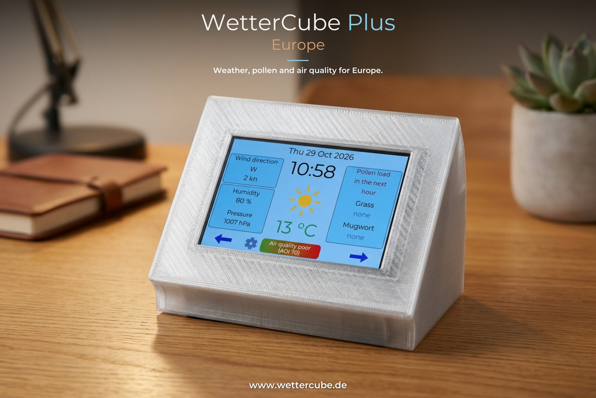
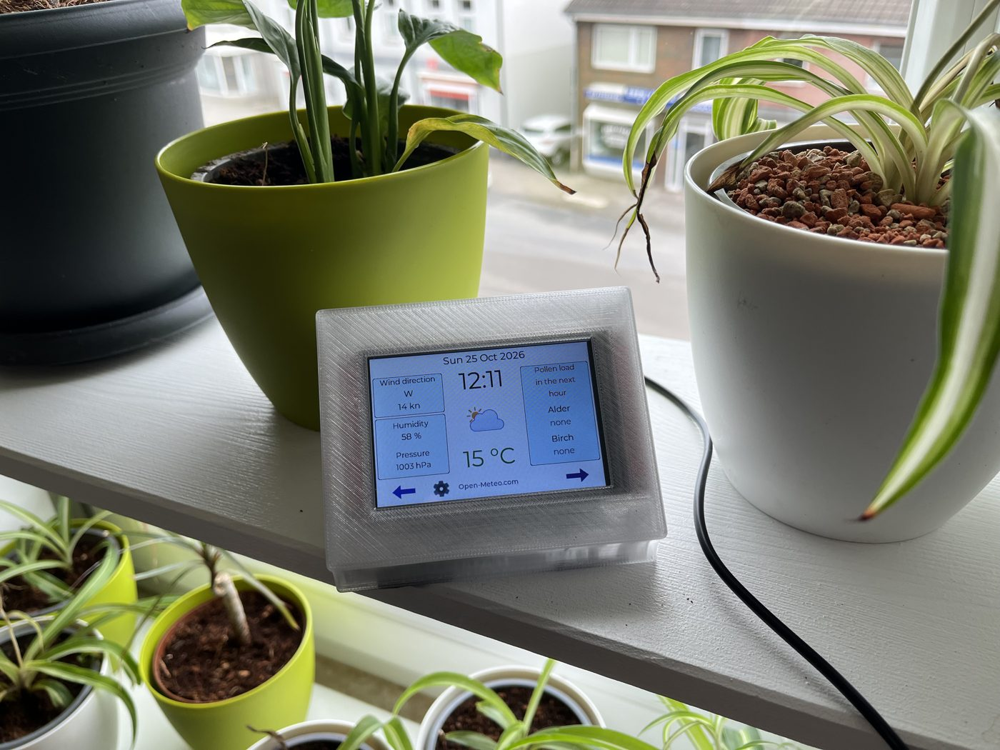

  

A compact Wi-Fi weather display for **Europe**, based on the **ESP32-S3 N16R8** with a 3.5" touch display: weather, pollen and air quality for your place, in English. It is the European version of the German [WetterCubePlus](https://github.com/JPPeterson-lab/WetterCubePlus), without the data of the German Weather Service (DWD), so it works in every country that Open-Meteo covers.

> **🧪 Beta:** Please try it and tell me what does not work: [open an issue](https://github.com/JPPeterson-lab/WetterCubePlus-Europe/issues) or use the [contact form](https://wettercube.de/en/contact/).
>
> **🛠️ Software project:** You build the device yourself; there are no finished devices. The hardware, wiring and case are the same as for the WetterCubePlus: [hardware and wiring](https://wiki.wettercube.de/index.php/WetterCubePlus/Hardware_und_Verkabelung/en).
>
> **⚖️ At your own risk:** No liability, see the [usage notes](https://wettercube.de/en/usage-notes/). Do not use for safety-critical purposes. The notices on the display are calculated from the forecast; they are **not** official weather warnings.

## 📸 How it looks when it is built

*A finished WetterCubePlus Europe in the printed case, running at home.*

## ✨ What it can do

- **Weather:** temperature (actual and feels-like), humidity, air pressure, wind (km/h, mph, m/s or knots), UV index, sun and moon, 4-hour forecast, 24-hour temperature curve with rain bars
- **Pollen forecast** for 4 days (alder, birch, grass, mugwort, olive, ragweed; choose your own allergens) and **air quality** (European AQI)
- **Notice tile** that is calculated from the forecast: thunderstorm, heavy rain, rain, storm gusts, heat, snow or ice, frost, strong UV, poor air quality and fast pressure falls; each notice can be switched off
- **Time zone** from your location, location search with a country filter, night mode, dark mode
- **Web interface** at `http://wettercubeplus-europe.local`, Wi-Fi setup without an app, back up and restore settings
- **Updates (OTA)** from the display or the browser, **WetterAmpel** interface, calculator and Bubblebreaker

Not included (compared with the German version): DWD weather warnings and warning map, rain radar and Biowetter, because there is no comparable free data for all countries.

## ⚡ Installation

1. **[Open the web installer](https://jppeterson-lab.github.io/WetterCubePlus-Europe/)** (Chrome or Edge only) and connect the ESP32-S3 via USB-C. Only tick "Erase device" if you want to delete the saved Wi-Fi data and settings.
2. At the first start do the **touch calibration** (tap 4 crosses), then connect to the Wi-Fi **"WetterCubePlus-Europe-Setup"**. The password is shown on the display; the portal opens by itself, otherwise open `192.168.4.1`.
3. Enter your Wi-Fi credentials, the **city and the country**, save. Afterwards the device is reachable at `http://wettercubeplus-europe.local`.

**Re-calibrate touch:** hold a finger on the display while booting. **Build from source:** open the folder in the Arduino IDE or use `tools/release_files.sh`; the board settings (ESP32-S3, PSRAM OPI, 16 MB flash, partition table `partitions.csv`) are described in the [wiki](https://wiki.wettercube.de/index.php/WetterCubePlus/Europe/en).

## 🧊 Case to print yourself

The case of the WetterCubePlus fits (lower part and lid, 3MF): in the folder [`gehaeuse/`](https://github.com/JPPeterson-lab/WetterCubePlus/tree/main/gehaeuse) of the WetterCubePlus repository and with a ready-made print profile on [Bambu MakerWorld](https://makerworld.com/de/models/3511219-wettercubeplus-enclosure-for-3-5-weather-display#profileId-4012174). Licence of the case: CC BY-NC-SA 4.0.

## 📖 Learn more

| Where | What |
|---|---|
| **[wettercube.de](https://wettercube.de/en/products/wettercubeplus/)** | overview of all WetterCubes, [build guide](https://wettercube.de/en/build-guide/), [hardware](https://wettercube.de/en/hardware/) |
| **[Wiki](https://wiki.wettercube.de/index.php/WetterCubePlus/Europe/en)** | settings, notices, updates, troubleshooting |
| **[Changelog](CHANGELOG.md)** | what is new in which version |

## 🙏 Credits and licence

  <a href="https://picopixel.io/"><picture>
    <source media="(prefers-color-scheme: dark)" srcset="https://wettercube.de/wp-content/themes/wettercube/assets/images/pico_dark_logo.png">
    
  </picture></a>

The LVGL user interface is created with [PicoPixel](https://picopixel.io). Weather data by [Open-Meteo.com](https://open-meteo.com) (CC BY 4.0; the free interface is for non-commercial use only). Pollen and air quality: Contains modified Copernicus Atmosphere Monitoring Service information, via Open-Meteo. Location data by [GeoNames](https://www.geonames.org) via Open-Meteo. Libraries, icons and fonts by third parties keep their own licences, details in [CREDITS.md](CREDITS.md).

| What | Licence | File |
|---|---|---|
| **Source code, firmware** | Apache 2.0 | [LICENSE](LICENSE), [NOTICE](NOTICE) |
| **Texts, images, documentation** | CC BY-NC 4.0 | [LICENSE-Dokumentation.txt](LICENSE-Dokumentation.txt) |
| **Third-party components** | their own licences (MIT, LGPL 2.1, Apache 2.0, SIL OFL, …) | [CREDITS.md](CREDITS.md) |

> **Promise:** Private use stays free in the future. The name "WetterCube" and the logos are not licensed, see [NOTICE](NOTICE).
